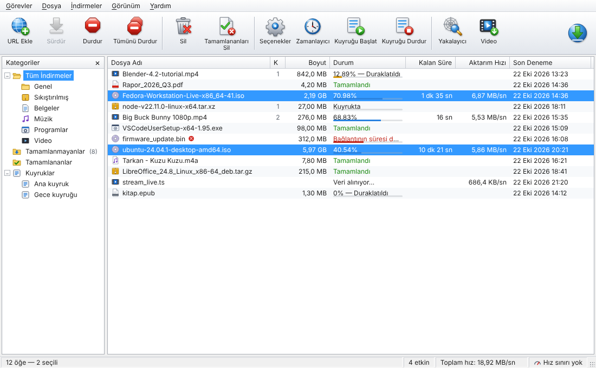
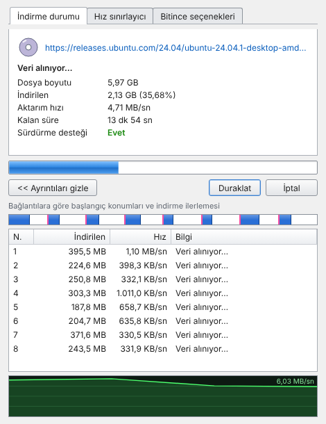
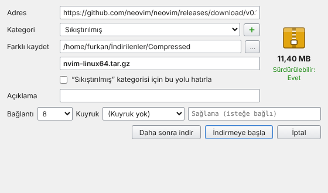
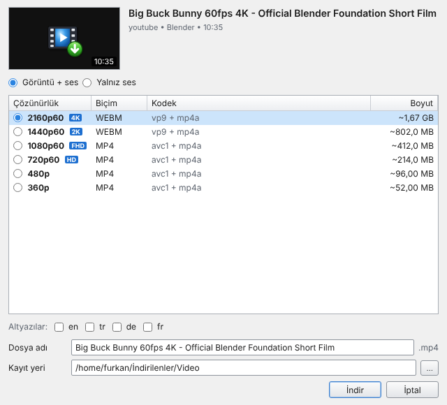
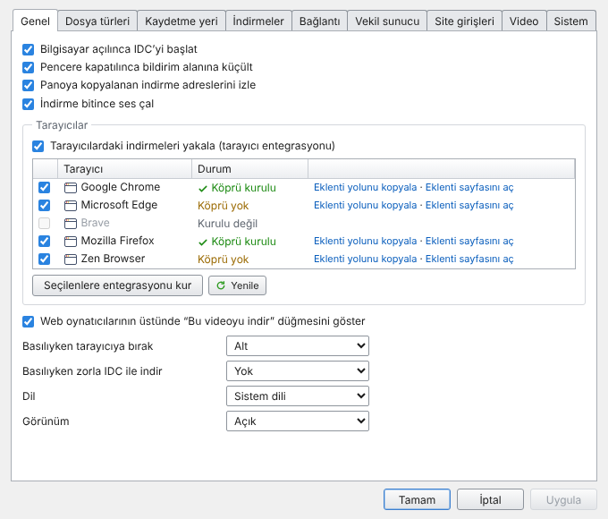
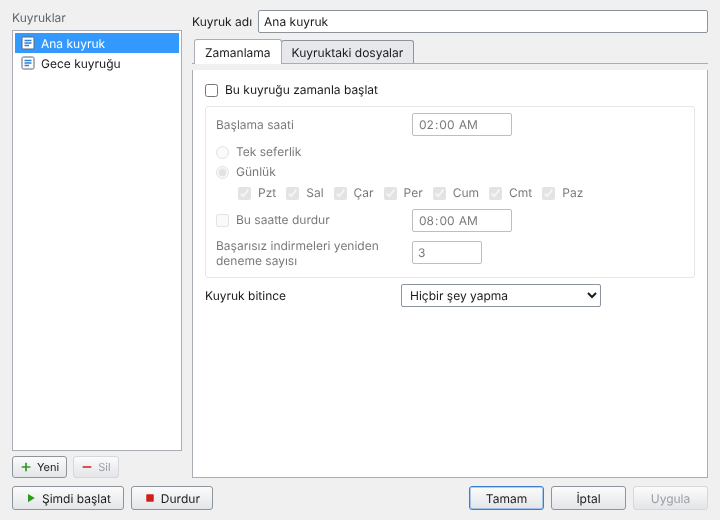
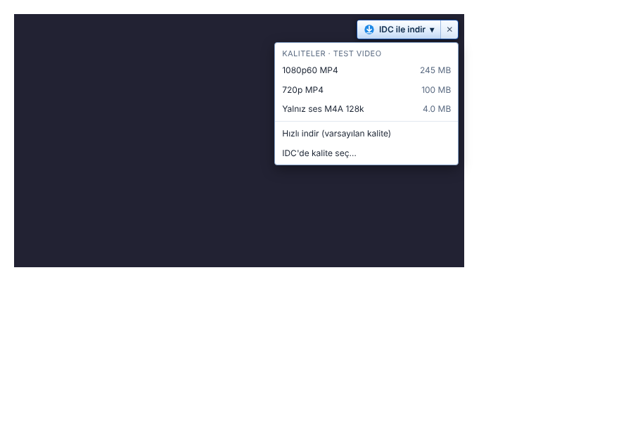

# Internet Download Center

Windows ve Linux için hızlı, çok bağlantılı indirme yöneticisi. Internet Download Manager'ın
alışılmış düzenini (araç çubuğu, kategoriler, ilerleme penceresi, dosya bilgisi penceresi) temel
alır, üstüne yeni özellikler ekler. Kodun tamamı özgündür; IDM'den kod, simge ya da ad alınmamıştır.



## Öne çıkanlar

- **Dinamik bölümleme:** Dosya varsayılan olarak 8, en çok 16 parçaya bölünür. Bağlantı sayısı
  ayarlardan, indirme başına "Dosya bilgisi" penceresinden ya da indirme sürerken değiştirilebilir.
  Boşta kalan bağlantı en büyük kalan parçayı ikiye bölüp ikinci yarıyı alır (IDM tarzı). Veri
  tek bir `.idcpart` dosyasına doğrudan yazılır, ayrıca birleştirme adımı yoktur.
- **Kesintisiz devam:** Parça konumları her 3 saniyede diske işlenir. Elektrik kesintisinden ya da
  uygulama kapanmasından sonra kaldığı yerden sürer. Sunucudaki dosya değiştiyse (ETag, boyut) bunu
  algılar.
- **Tarayıcı oturumunu taşır:** Eklenti, isteğin gerçek başlıklarını ve HttpOnly ile bölümlenmiş
  (CHIPS) çerezler dahil tüm çerezleri uygulamaya aktarır. Giriş gerektiren indirmeler de yakalanır.
- **Engellemeye karşı katmanlar:**
  1. Tarayıcı isteğinin birebir kopyası gönderilir: çerezler, `User-Agent`, `Referer`, `sec-ch-ua*`.
  2. Sunucu fazla bağlantıyı reddederse (403/429/503) bağlantı sayısı kendiliğinden düşürülür.
  3. Doğrudan istek engellenirse isteğe bağlı olarak `yt-dlp --impersonate chrome` (Chrome TLS
     parmak izi) ile denenir.
  4. Hepsi başarısız olursa indirme **tarayıcıya geri verilir**; duraklatılan tarayıcı indirmesi
     sürer ve hiçbir indirme kaybolmaz.
  5. Süresi dolan bağlantıda aynı dosyaya tarayıcıda yeniden tıklamak yeterlidir. IDC aynı ad ve
     boyuttaki yarım indirmeyi bulur, adresini yeniler ve kaldığı yerden sürdürür.
- **Video yakalama:** Sayfadaki `<video>` öğelerinin üstüne "IDC ile indir" düğmesi eklenir.
  YouTube, Vimeo, X, Instagram, TikTok, Twitch, Dailymotion ve yt-dlp'nin desteklediği 1000'den
  fazla sitede çözünürlük, FPS, HDR, kodek ve boyuta göre kalite seçilebilir. Yalnız ses (M4A, MP3,
  Opus) ve altyazı da indirilebilir. HLS (`.m3u8`) ve DASH (`.mpd`) akışları ağdan yakalanır. yt-dlp,
  ffmpeg ve deno ilk ihtiyaçta otomatik kurulur, yt-dlp haftada bir güncellenir.
- **Varsayılan indirici:** Eklenti açıkken tarayıcıda başlayan indirmeler IDC'ye geçer.
  - `Alt` + tıklama indirmeyi tarayıcıya bırakır. Hangi tuşun bırakıp hangisinin zorla IDC'ye
    vereceği ayarlanabilir.
  - Hangi uzantıların yakalanacağı, hangi uzantı, site ve adreslerin atlanacağı, en küçük dosya
    boyutu ayarlanabilir.
- **IDM'deki diğer özellikler:**
  - İndirmeleri yönetme: kategoriler ve kategoriye göre kayıt klasörleri, kuyruklar, zamanlayıcı
    (başlama ve durma saati, günler, tek seferlik tarih).
  - Bitince yapılacaklar: kapat, uyku, hazırda beklet ya da çık; işlemden önce 60 sn iptal süresi.
  - Hız ve bağlantı: genel ve indirme başına hız sınırlayıcı, sunucu başına bağlantı sınırları.
  - Adres kaynakları: pano izleme, toplu indirme (`resim*.jpg`, 001–100, a–z), site yakalayıcı
    (derinlik ve uzantı süzgeci), "Tüm bağlantıları IDC ile indir".
  - Ağ ve kimlik: vekil sunucu (HTTP/SOCKS5), site girişleri.
  - Bitmiş dosyalar: sağlama doğrulaması (MD5/SHA-1/SHA-256/SHA-512), virüs tarama komutu.
  - Liste ve görünüm: listeyi içe/dışa aktarma, tepsi simgesi, bildirimler, koyu tema,
    Türkçe/İngilizce arayüz.
- **Güvenlik:**
  - İnen dosyalar internetten geldiği olarak işaretlenir: Windows'ta `Zone.Identifier`
    (SmartScreen), Linux'ta `user.xdg.origin.url`.
  - Ayar dosyası yalnız kullanıcıya açıktır (0600).
  - Yerel API yalnız `127.0.0.1` üzerinden ve rastgele bir belirteçle erişilebilir.

| İlerleme penceresi | Dosya bilgisi | Video kalitesi |
|---|---|---|
|  |  |  |

| Seçenekler | Zamanlayıcı | Tarayıcıdaki video düğmesi |
|---|---|---|
|  |  |  |

## Kurulum

[Sürümler](https://github.com/fyildirim-debug/internetdownloadcenter/releases) sayfasından:

| Sistem | Dosya |
|---|---|
| Windows 10/11 | `InternetDownloadCenter_x.y.z_x64_setup.exe` (kurulum) ya da `..._portable.zip` (kurulumsuz) |
| Ubuntu, Debian, Mint, Pop!_OS | `InternetDownloadCenter_x.y.z_amd64.deb` |
| Fedora, openSUSE, RHEL | `InternetDownloadCenter-x.y.z.x86_64.rpm` |
| Diğer dağıtımlar | `InternetDownloadCenter_x.y.z_x86_64.AppImage` |

İlk açılışta bir sihirbaz şunları sorar ve kurar: dil, indirme klasörü, tarayıcı entegrasyonu,
sistem entegrasyonu ve video araçları.

- `.deb` ve `.rpm` paketleri tarayıcı köprüsünü sistem genelinde kaydeder (tüm kullanıcılar,
  tüm tarayıcılar).
- Taşınabilir Windows sürümü ayarlarını kendi klasöründeki `data` altında tutar.

### Tarayıcı eklentisi

Uygulama, bilgisayardaki tarayıcıları bulur ve köprüyü (`com.furkanyildirim.idc`) her biri için
kaydeder. Eklentinin kendisi tarayıcıya bir kez yüklenir. Seçenekler > Genel'deki
"Eklenti yolunu kopyala" ve "Eklenti sayfasını aç" bağlantıları bu işi kolaylaştırır.

**Chrome, Edge, Brave, Opera ve Vivaldi**

1. Eklenti sayfasını açın: `chrome://extensions`, `edge://extensions` …
2. **Geliştirici modu**nu açın.
3. **Paketlenmemiş öğe yükle**'ye basın ve uygulamanın gösterdiği klasörü seçin:
   - Linux: `~/.config/internet-download-center/extension/chromium`
   - Windows: `%APPDATA%\InternetDownloadCenter\extension\chromium`

**Firefox, Zen, LibreWolf ve Floorp**

- Mozilla imzalı sürüm (sürüm sayfasında `idc-firefox-signed.xpi` varsa): dosyayı tarayıcıya
  sürükleyin.
- Zen, LibreWolf, Firefox Developer Edition ve Nightly'de imzasız kurulum:
  1. `about:config` sayfasında `xpinstall.signatures.required` değerini `false` yapın.
  2. `idc-firefox.xpi` dosyasını tarayıcıya sürükleyin.
- Firefox'un normal sürümü imzasız eklenti kabul etmez. İmzalı paketi kendiniz üretmek için:
  1. AMO'dan bir API anahtarı alın.
  2. Bu anahtarı depo sırlarına `AMO_JWT_ISSUER` ve `AMO_JWT_SECRET` olarak ekleyin.
  3. Sürüm iş akışı `web-ext sign --channel unlisted` ile imzalı `.xpi`'yi kendisi üretir.

Tarayıcınızda "Her dosyanın nereye kaydedileceğini sor" açıksa kapatın; yoksa tarayıcının kendi
penceresi IDC'den önce açılır.

### İşletim sistemi entegrasyonu

Windows ve Linux masaüstlerinin işletim sistemi düzeyinde bir "varsayılan indirme yöneticisi"
ayarı yoktur. Bu görevi tarayıcılarda eklenti üstlenir. Bunun dışında IDC kendini şu yerlere
ekler:

| Özellik | Windows | Linux (KDE, GNOME, XFCE, Cinnamon, MATE…) |
|---|---|---|
| Başlangıçta çalıştır | Kayıt defteri `Run` | `~/.config/autostart` |
| `idc://` bağlantı işleyicisi | `HKCU\Software\Classes\idc` | `x-scheme-handler/idc` (xdg-mime) |
| Varsayılan indirme yöneticisi | – | KDE Konqueror (`konquerorrc` → `DownloadManager`) |
| Komut satırı / "Birlikte aç" | `internet-download-center.exe <adres>` | `internet-download-center <adres>` |
| Tepsi simgesi | Var | Var. GNOME'da "AppIndicator" uzantısı gerekir; sihirbaz uyarır |

## Kullanım ipuçları

- **Kalite seçmeden indirmek:** Videonun üstündeki düğmeden "Hızlı indir" ayardaki varsayılan
  kaliteyle indirir. "IDC'de kalite seç…" tam listeyi açar.
- **Süresi dolan bağlantı:** Bağlantının süresi dolduysa (403/410) aynı dosyaya tarayıcıda yeniden
  tıklayın; indirme yeni adresle kaldığı yerden sürer. Elle yenilemek için Özellikler'den adresi
  değiştirin.
- **Pano izleme:** İndirilebilir bir adres kopyalandığında "Dosya bilgisi" penceresi kendiliğinden
  açılır.
- **YouTube:** Bulut sunucularında YouTube "bot değilim" doğrulaması isteyebilir. Eklenti tarayıcı
  çerezlerini yt-dlp'ye aktardığı için evdeki bilgisayarda bu sorun çıkmaz.

## Mimari

```
Tarayıcı eklentisi ──yerel mesajlaşma──▶ idc-host ──127.0.0.1 + belirteç──▶ IDC (Tauri 2)
                                                                              │
                         Svelte 5 arayüzü ◀──olaylar── idc-core (Rust/tokio) ◀┘
```

| Dizin | İçerik |
|---|---|
| `crates/idc-core` | İndirme motoru: bölümleme, devam, hız sınırı, kuyruk, zamanlayıcı, yt-dlp, araç yöneticisi |
| `crates/idc-host` | Tarayıcı köprüsü (küçük konsol programı) |
| `src-tauri` | Masaüstü uygulaması: komutlar, pencereler, tepsi, yerel API, tarayıcı ve sistem entegrasyonu |
| `ui` | Arayüz (Svelte 5 + TypeScript), her pencere bir rota |
| `extension` | Chromium (MV3) ve Firefox eklentisi |
| `packaging` | Linux masaüstü dosyası, deb/rpm betikleri, NSIS kancaları, simgeler |

Ayrıntılar: [docs/MIMARI.md](docs/MIMARI.md), test kayıtları: [docs/TEST.md](docs/TEST.md).

## Kaynaktan derleme

Gerekenler: Rust (stable), Node.js 22. Linux'ta ayrıca
`libwebkit2gtk-4.1-dev libayatana-appindicator3-dev librsvg2-dev libxdo-dev patchelf rpm`.

```sh
npm ci --prefix ui
scripts/sidecar.sh release              # idc-host köprüsünü derler
npx @tauri-apps/cli@2 build             # Linux: deb, rpm, AppImage · Windows: NSIS
```

Geliştirme: `npx @tauri-apps/cli@2 dev`. Yalnız arayüz için `npm --prefix ui run dev`; tarayıcıda
sahte bir arka uçla çalışır.

Testler: `cargo test --workspace` (motorun uçtan uca testleri dahil), `npm --prefix ui run check`.

## Lisans

MIT. Ayrıntı için [LICENSE](LICENSE). yt-dlp, ffmpeg ve deno ayrı programlardır ve kendi
lisanslarıyla gelir. IDC bunları paketlemez, ilk ihtiyaçta resmi sürüm sayfalarından indirir.
